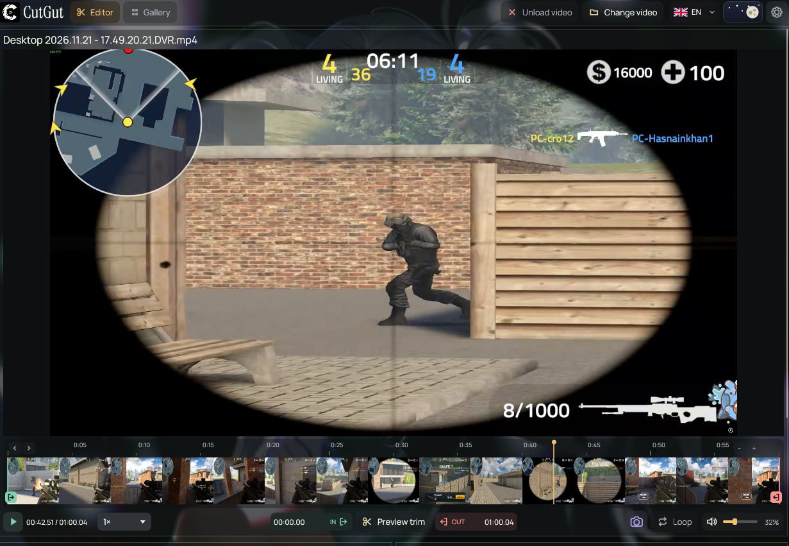
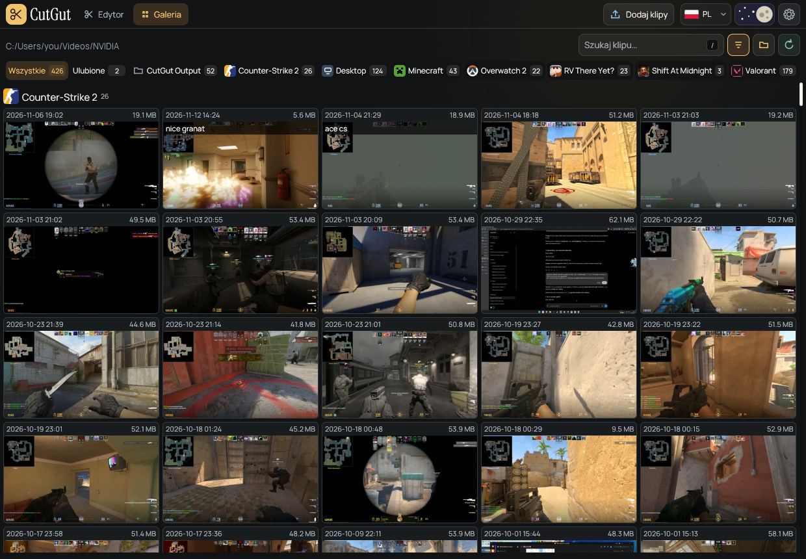
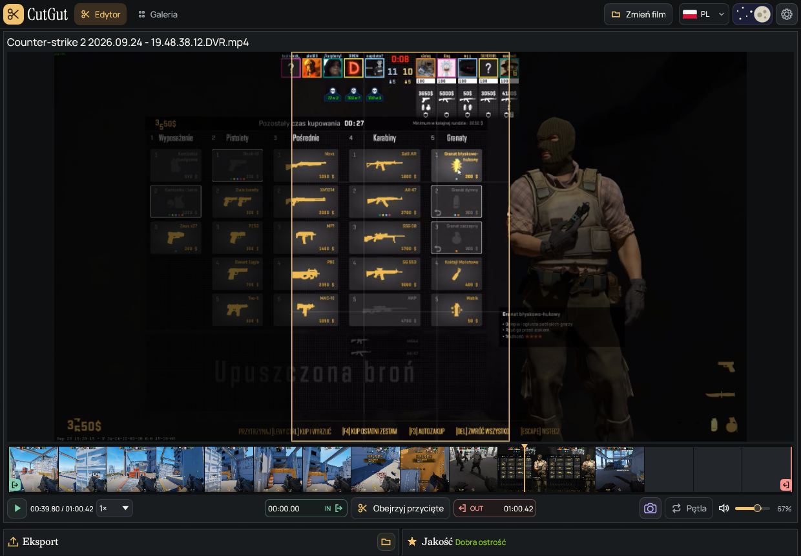
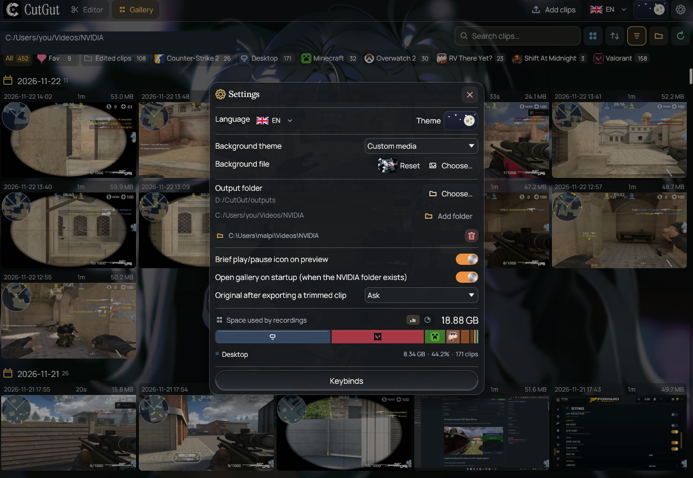

# CutGut

[](https://github.com/Zeluqe/CutGut/actions/workflows/ci.yml)
[](LICENSE)
[](#requirements)

[Polska wersja](README.pl.md)

CutGut takes a full gameplay recording and gives you the clip back at a size you picked.
Trim it, crop it for vertical or square, choose 20 MB, 50 MB or 500 MB, and it works out
the bitrate, encodes the file and checks the result. If the output lands over the limit, it
re-plans and tries again instead of quietly handing you a file that Discord will reject.

I built it for my own NVIDIA replays. The loop I wanted to get rid of was: open a converter,
guess a bitrate, export, check the size, export again. CutGut is that loop in one window.



## What it does

- **Trim with frame-accurate IN/OUT points.** The timeline shows real frames from the clip,
  and `,` / `.` move one frame at a time.
- **Crop for where the clip is going.** 9:16 for Shorts/TikTok, 1:1 for feeds, 16:9 for
  YouTube, or keep the original frame. Rotation metadata from phone recordings is respected.
- **A hard size limit.** The target is a real byte budget (`20 MB = 20 000 000 bytes`), not
  "roughly 20 MB". The encoded file is verified and re-encoded with a new plan if it overshoots.
- **H.264, HEVC and AV1.** NVENC or AMF when the GPU supports it, CPU otherwise. Encoder
  support is checked by actually encoding a frame, not by parsing `ffmpeg -encoders`.
- **Remux before re-encode.** If the clip already fits and only needs a container change,
  it is copied instead of encoded again. If a cut misses the nearest keyframe, the export
  falls back to an exact re-encode rather than returning a file with extra seconds.
- **A gallery instead of a file picker.** Clips from your recordings folder are grouped by
  game, with thumbnails, search, favourites, multi-select and a storage breakdown. Useful
  when you remember the match, not the filename.

## Gallery

The gallery scans `Videos\NVIDIA` (or any folders you add), groups clips by game and caches
thumbnails. Storage is attributed per game, so it is easy to see what is actually eating
the drive before deleting anything.



The clip preview steps one frame at a time (`,` `.` `[` `]`, Shift+←/→, `Home`/`End`), shows
a `2×`/`0.5×` badge while the picture is held down, and always animates its way out: the
picture flies back into its card, or shrinks in place when that card is scrolled away.
Deleting the clip being watched keeps the preview open on its neighbour, and *Edit in
CutGut* opens the editor immediately instead of animating back to the grid first.

<details>
<summary>More screenshots</summary>





</details>

## Requirements

- Windows 10 or 11 (the app uses `waveOut`, OLE drag-out and `%APPDATA%`).
- [FFmpeg](https://ffmpeg.org/) with `ffmpeg.exe` and `ffprobe.exe` in `PATH`, or both files
  next to `CutGut.exe`. The build does not bundle FFmpeg.
- For hardware encoding: a current NVIDIA or AMD driver. AV1 hardware encoding needs an
  RTX 40-series / RDNA 3 card or newer; older GPUs fall back to CPU.

## Running

There is no installer. A release contains `CutGut.exe` for the app and `cutgut-cli.zip` with
the CLI (`cutgut.exe`). Download the
[latest release](https://github.com/Zeluqe/CutGut/releases/latest), or build it below.

1. Put `ffmpeg.exe` and `ffprobe.exe` in `PATH`, or next to `CutGut.exe`.
2. Run `CutGut.exe`.

Settings and logs live in `%APPDATA%\CutGut`. Logs are written to
`%APPDATA%\CutGut\logs` and the app has a button that opens that folder after a failed export.

## Building from source

Rust stable with the MSVC toolchain is enough. The build script embeds the icon and
version info, so the Windows SDK has to be present; FFmpeg is only needed at runtime.

```bat
cargo build --release --manifest-path cutgut-gui\Cargo.toml
copy cutgut-gui\target\release\cutgut-gui.exe CutGut.exe
```

The engine and CLI are a separate crate:

```bat
cargo build --release --manifest-path cutgut-rs\Cargo.toml
cutgut-rs\target\release\cutgut.exe --help
```

Tests use a real FFmpeg. The export tests cut a short generated clip, check that the cut
starts and ends where it should and that the result stays under the byte limit:

```bat
cargo test --manifest-path cutgut-rs\Cargo.toml
cargo test --manifest-path cutgut-gui\Cargo.toml
```

The same checks run on `windows-latest` in GitHub Actions on every push.

## CLI

The GUI is built on the same engine, and the engine is usable on its own:

```bat
cutgut probe gameplay.mp4
cutgut engines
cutgut plan gameplay.mp4 --start 10 --end 40 --target 20 --codec av1
cutgut encode gameplay.mp4 --out out.mp4 --start 10 --end 40 --target 20 --codec av1 --gpu
cutgut audio gameplay.mp4 --out out.m4a --format m4a
cutgut gallery "%USERPROFILE%\Videos\NVIDIA"
```

Common options: `--start`, `--end`, `--target` (MB), `--codec h264|hevc|av1`,
`--speed hq|fast|balanced`, `--cpu` / `--gpu`, `--crop original|16:9|9:16|1:1`,
`--lang pl|en`, `--quiet`.

## How the size limit works

The target is converted to bytes, audio and container overhead are subtracted, and the rest
becomes the video bitrate. The plan also caps bits per pixel, because a 500 MB limit on a
five-second clip would otherwise ask NVENC for a gigabit per second. After encoding, the file
is measured and the whole thing is retried with a corrected plan if needed.

The full write-up, including measured VMAF numbers for AV1/HEVC/H.264 and the reasoning
behind the 4% safety margin, is in
[docs/EXPORT_QUALITY_AND_HARD_LIMIT.md](docs/EXPORT_QUALITY_AND_HARD_LIMIT.md) (Polish).

## Known limitations

- Windows only. Nothing here is portable to Linux or macOS without replacing the audio and
  drag-and-drop code.
- No installer and no auto-update. Updating means replacing the executable.
- The executables are not code-signed, so Windows SmartScreen will ask for confirmation the
  first time you run them.
- The interface is Polish and English; the technical documentation is Polish only for now.
- The first scan of a large gallery takes a while because every thumbnail is generated. Later
  runs use the cache in `%APPDATA%\CutGut`.
- AV1 on CPU is slow. It is the best option for a tight size limit, but a two-minute clip can
  take a few minutes to encode.

## Credits

Fonts are Geist, Manrope, Instrument Serif and Redaction, all under the SIL Open Font License.
Game icons are display-sized copies of official artwork; sources and owners are listed in
[cutgut-gui/assets/games/SOURCES.md](cutgut-gui/assets/games/SOURCES.md). Encoding is done by
[FFmpeg](https://ffmpeg.org/).

## License

MIT. See [LICENSE](LICENSE).
