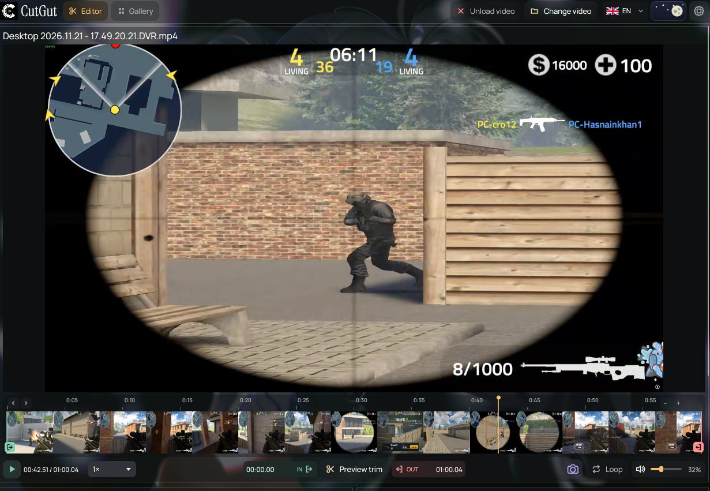
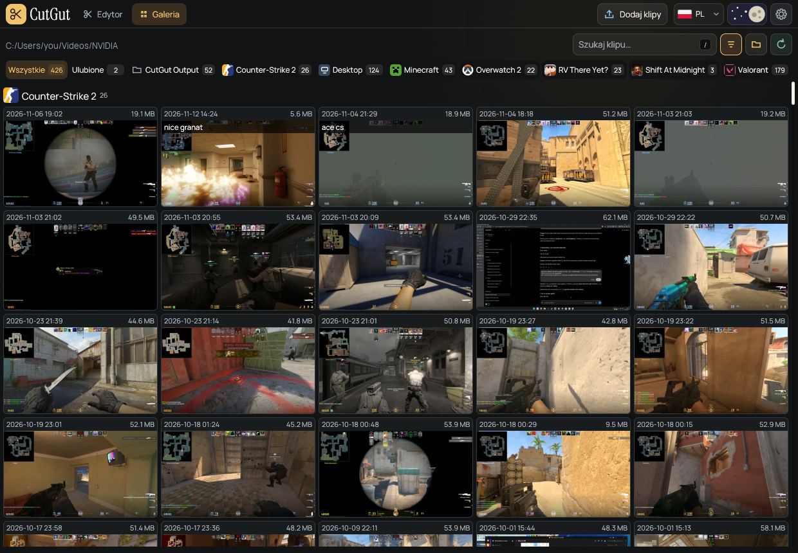
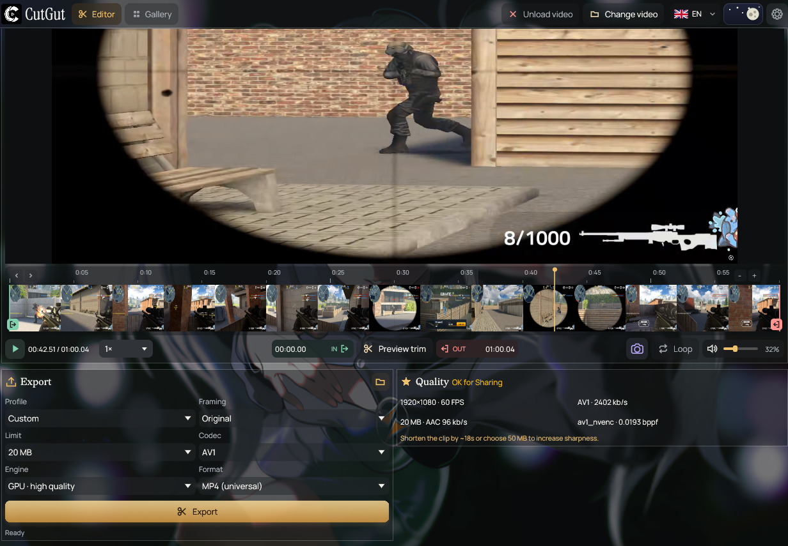
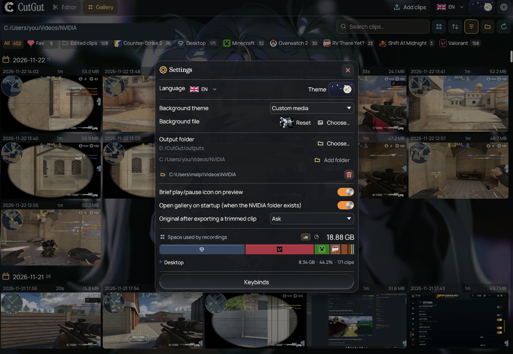

# CutGut

[](https://github.com/Zeluqe/CutGut/actions/workflows/ci.yml)
[](LICENSE)
[](#wymagania)

[English version](README.md)

CutGut jest zrobiony pod nagrywarkę wbudowaną w NVIDIA. NVIDIA zapisuje każdy mecz do
`Videos\NVIDIA` z datą i godziną w nazwie; CutGut otwiera ten folder, grupuje klipy po grach
i pokazuje ten, który pamiętasz, zamiast kazać szukać go w Eksploratorze. Wytnij fragment,
przytnij go pod pion albo kwadrat, ustaw darmowy limit 20 MB na Discord i wyślij klip
znajomym.

Pod spodem program liczy bitrate, koduje przez FFmpeg, mierzy gotowy plik i ponawia plan,
jeśli wynik przekroczy limit. Nie opiera się na „około 20 MB”.

Zrobiłem to dla swoich klipów. Chciałem pozbyć się jednego schematu: otwórz konwerter,
zgadnij bitrate, eksportuj, sprawdź rozmiar, eksportuj ponownie. CutGut to ten sam schemat,
tylko w jednym oknie.



## Co potrafi

- **Cięcie co do klatki.** Oś czasu pokazuje prawdziwe klatki z klipu, a `,` i `.` przesuwają
  punkt o jedną klatkę.
- **Kadrowanie pod miejsce docelowe.** 9:16 pod Shorts/TikTok, 1:1 pod feed, 16:9 pod YouTube
  albo oryginał. Rotacja z metadanych (nagrania z telefonu) jest uwzględniana.
- **Twardy limit rozmiaru.** Cel to prawdziwy budżet bajtowy (`20 MB = 20 000 000 bajtów`).
  Po eksporcie plik jest mierzony, a jeśli przekroczył limit, kodowanie leci ponownie z nowym
  planem.
- **H.264, HEVC i AV1.** NVENC albo AMF, gdy GPU to obsługuje, w przeciwnym razie CPU.
  Dostępność enkodera jest sprawdzana realnym zakodowaniem klatki, a nie listą z `ffmpeg
  -encoders`.
- **Remux przed rekompresją.** Jeśli klip już się mieści i wystarczy zmiana kontenera, dane
  są kopiowane. Jeśli cięcie nie trafi w klatkę kluczową, eksport przechodzi na dokładną
  rekompresję, zamiast doklejać sekundy z okolic cięcia.
- **Galeria zamiast wyboru pliku.** Klipy z folderu nagrań są grupowane po grach, z miniaturami,
  wyszukiwaniem, ulubionymi, zaznaczaniem wielu plików i podziałem zajętego miejsca. Przydaje
  się, gdy pamiętasz mecz, a nie nazwę pliku.

## Galeria

Galeria skanuje `Videos\NVIDIA` (albo dowolne dodane foldery), grupuje klipy po grach i trzyma
miniatury w cache. Miejsce na dysku jest liczone per gra, więc przed usuwaniem widać, co
naprawdę zajmuje miejsce.



Podgląd klipu w galerii ma krok klatkowy (`,` `.` `[` `]`, Shift+←/→, `Home`/`End`),
badge tempa `2×`/`0.5×` przy przytrzymaniu lewego przycisku i animowane wyjście: obraz
wraca do kafelka, a gdy kafelek jest poza ekranem — kurczy się w miejscu. Usunięcie
oglądanego klipu nie zamyka podglądu, tylko przeskakuje do sąsiedniego, a `Edytuj w CutGut`
wchodzi do edytora od razu.

<details>
<summary>Więcej zrzutów</summary>





</details>

## Wymagania

- Windows 10 lub 11 (aplikacja używa `waveOut`, OLE drag-out i `%APPDATA%`).
- [FFmpeg](https://ffmpeg.org/) z `ffmpeg.exe` i `ffprobe.exe` w `PATH` albo obok
  `CutGut.exe`. FFmpeg nie jest dołączony do builda.
- Do kodowania sprzętowego: aktualny sterownik NVIDIA lub AMD. AV1 sprzętowo wymaga karty
  RTX 40-series / RDNA 3 lub nowszej; starsze GPU przechodzą na CPU.

## Uruchomienie

Nie ma instalatora. Wydanie zawiera `CutGut.exe` dla aplikacji oraz `cutgut-cli.zip` z CLI
(`cutgut.exe`). Pobierz
[najnowsze wydanie](https://github.com/Zeluqe/CutGut/releases/latest) albo zbuduj całość
ze źródeł (poniżej).

1. Wrzuć `ffmpeg.exe` i `ffprobe.exe` do `PATH` albo obok `CutGut.exe`.
2. Uruchom `CutGut.exe`.

Ustawienia i logi są w `%APPDATA%\CutGut`. Logi trafiają do `%APPDATA%\CutGut\logs`, a po
nieudanym eksporcie okno błędu ma przycisk otwierający ten folder.

## Budowanie ze źródeł

Wystarczy Rust stable z toolchainem MSVC. Build script osadza ikonę i wersję, więc Windows
SDK musi być dostępny; FFmpeg jest potrzebny dopiero w czasie działania.

```bat
cargo build --release --manifest-path cutgut-gui\Cargo.toml
copy cutgut-gui\target\release\cutgut-gui.exe CutGut.exe
```

Silnik i CLI to osobny crate:

```bat
cargo build --release --manifest-path cutgut-rs\Cargo.toml
cutgut-rs\target\release\cutgut.exe --help
```

Testy używają prawdziwego FFmpeg. Testy eksportu wycinają krótki wygenerowany klip, sprawdzają
czy cięcie zaczyna się i kończy tam, gdzie powinno, i czy plik nie przekracza limitu bajtów:

```bat
cargo test --manifest-path cutgut-rs\Cargo.toml
cargo test --manifest-path cutgut-gui\Cargo.toml
```

Te same testy lecą na `windows-latest` w GitHub Actions przy każdym pushu.

## CLI

GUI korzysta z tego samego silnika, a silnik da się użyć osobno:

```bat
cutgut probe gameplay.mp4
cutgut engines
cutgut plan gameplay.mp4 --start 10 --end 40 --target 20 --codec av1
cutgut encode gameplay.mp4 --out out.mp4 --start 10 --end 40 --target 20 --codec av1 --gpu
cutgut audio gameplay.mp4 --out out.m4a --format m4a
cutgut gallery "%USERPROFILE%\Videos\NVIDIA"
```

Wspólne opcje: `--start`, `--end`, `--target` (MB), `--codec h264|hevc|av1`,
`--speed hq|fast|balanced`, `--cpu` / `--gpu`, `--crop original|16:9|9:16|1:1`,
`--lang pl|en`, `--quiet`.

## Jak działa limit rozmiaru

Limit jest przeliczany na bajty, odejmowane są audio i narzut kontenera, a reszta trafia do
bitrate'u wideo. Plan ogranicza też bity na piksel, bo limit 500 MB na pięciosekundowym klipie
poprosiłby NVENC o gigabit na sekundę. Po kodowaniu plik jest mierzony i w razie potrzeby
całość leci ponownie z poprawionym planem.

Pełny opis, razem z pomiarami VMAF dla AV1/HEVC/H.264 i uzasadnieniem 4% zapasu, jest w
[docs/EXPORT_QUALITY_AND_HARD_LIMIT.md](docs/EXPORT_QUALITY_AND_HARD_LIMIT.md). Wersja polska:
[docs/EXPORT_QUALITY_AND_HARD_LIMIT.pl.md](docs/EXPORT_QUALITY_AND_HARD_LIMIT.pl.md).

## Znane ograniczenia

- Tylko Windows. Przeniesienie na Linuksa lub macOS wymaga wymiany kodu audio i
  przeciągania plików.
- Brak instalatora i auto-update'u. Aktualizacja to podmiana pliku exe.
- Pliki exe nie są podpisane, więc Windows SmartScreen zapyta o potwierdzenie przy pierwszym
  uruchomieniu.
- Interfejs i dokumentacja są po angielsku i polsku; domyślnie włącza się angielski.
- Pierwsze skanowanie dużej galerii trochę trwa, bo każda miniatura jest generowana. Kolejne
  uruchomienia korzystają z cache miniatur w `temp\gallery_cache` obok pliku exe.
- Plik exe ma około 57 MB, bo w środku siedzą tła i 26 pętli animowanych. Działają offline;
  pętle są w 960x540 i są rysowane pod przyciemnieniem.
- AV1 na CPU jest wolne. Przy ciasnym limicie daje najlepszy wynik, ale dwuminutowy klip może
  kodować się kilka minut.

## Źródła

Czcionki to Geist, Manrope, Instrument Serif i Redaction, wszystkie na licencji SIL Open Font
License. Ikony gier to zmniejszone kopie oficjalnych grafik; źródła i właściciele są wypisani
w [cutgut-gui/assets/games/SOURCES.md](cutgut-gui/assets/games/SOURCES.md). Kodowanie robi
[FFmpeg](https://ffmpeg.org/).

## Licencja

MIT. Szczegóły w [LICENSE](LICENSE).
